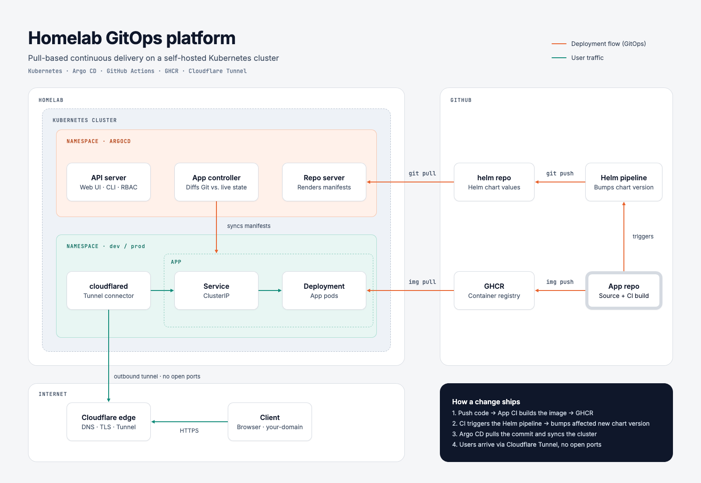

# helm

The GitOps (infra) repository for my homelab: a Kubernetes cluster running on a
Raspberry Pi. The cluster pulls its desired state from this repo, and the apps
it runs are reached from the internet through a Cloudflare Tunnel, so no ports
are opened on the home network.

## Overview



> **Disclaimer:** this diagram is a very broad overview.

### How it works

1. **An app repository** (for example
   [portfolio-frontend](https://github.com/chris911e/portfolio-frontend))
   builds a container image in GitHub Actions and pushes it to
   `ghcr.io`. The new version then has to land in this repo's values files.
2. **This infra repository** is the single source of truth for what runs
   in the cluster: one Helm chart per app, plus the per-environment values.
3. **The GitOps controller** in the cluster watches this repo, detects
   changes on `main` and applies the rendered manifests. Automated sync with
   `prune` and `selfHeal` keeps the cluster matching Git, including undoing
   manual changes.
4. **The app** runs as a Deployment behind a ClusterIP Service. Nothing is
   exposed outside the cluster directly.
5. **cloudflared** opens an outbound connection to Cloudflare and forwards
   tunnel traffic to the app's Service.
6. **A client** visits the public domain; Cloudflare routes the request
   through the tunnel into the cluster.

## Charts

| Chart | What it runs | Namespace (dev) |
| --- | --- | --- |
| [`portfolio-frontend`](portfolio-frontend/) | The portfolio site image from `ghcr.io/chris911e/portfolio-frontend` | `dev` |
| [`cloudflared`](cloudflared/) | Cloudflare Tunnel connector (remotely managed tunnel) | `cloudflared` |

## Layout

```text
.
├── argocd/
│   ├── dev/                  → Argo CD Applications for dev
│   └── prod/                 → Argo CD Applications for prod
├── docs/                     → diagrams
└── <chart>/                  → one per app
    ├── Chart.yaml
    ├── values.yaml           → base values
    ├── values-<env>.yaml     → per-environment overrides, merged on top
    └── templates/
```

Each Argo CD `Application` renders its chart with `values.yaml` followed by the
environment file, syncs automatically (`prune` and `selfHeal`), and creates its
namespace if it is missing.

## Deploying

To deploy a chart, add an Argo CD `Application` for it in `argocd/<env>/` and
push to `main`. Argo CD picks it up from there:

```yaml
apiVersion: argoproj.io/v1alpha1
kind: Application
metadata:
  name: <chart>-<env>
  namespace: argocd
spec:
  project: default
  source:
    repoURL: git@github.com:chris911e/helm.git
    targetRevision: HEAD
    path: <chart>
    helm:
      valueFiles:
        - values.yaml
        - values-<env>.yaml
  destination:
    server: https://kubernetes.default.svc
    namespace: <namespace>
  syncPolicy:
    automated:
      prune: true
      selfHeal: true
    syncOptions:
      - CreateNamespace=true
```


## Required secrets

The charts read credentials from Secrets that are not stored in this repo.
Create them in each namespace before syncing:

| Namespace | Secret | Key | Used by |
| --- | --- | --- | --- |
| `dev` | `ghcr-pull` | (docker-registry) | image pulls |
| `cloudflared` | `cloudflared-token` | `token` | cloudflared tunnel token |

For example:

```sh
kubectl -n dev create secret docker-registry ghcr-pull \
  --docker-server=ghcr.io --docker-username=<user> --docker-password=<token>

kubectl -n cloudflared create secret generic cloudflared-token --from-literal=token=<token>
```

The tunnel's public hostname and the Service it routes to are configured in
the Cloudflare dashboard (remotely managed tunnel), not in this repo.

## Rendering locally

```sh
helm template portfolio-frontend ./portfolio-frontend \
  -f portfolio-frontend/values.yaml -f portfolio-frontend/values-dev.yaml
```
